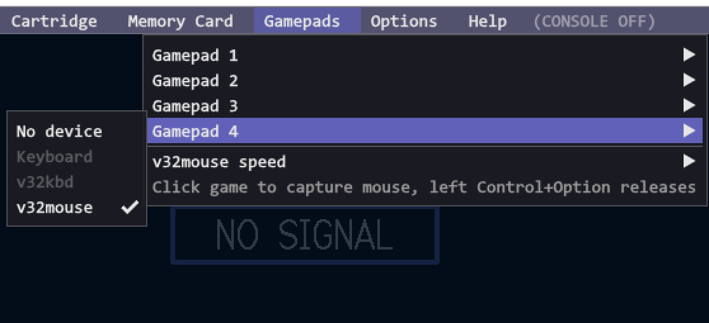
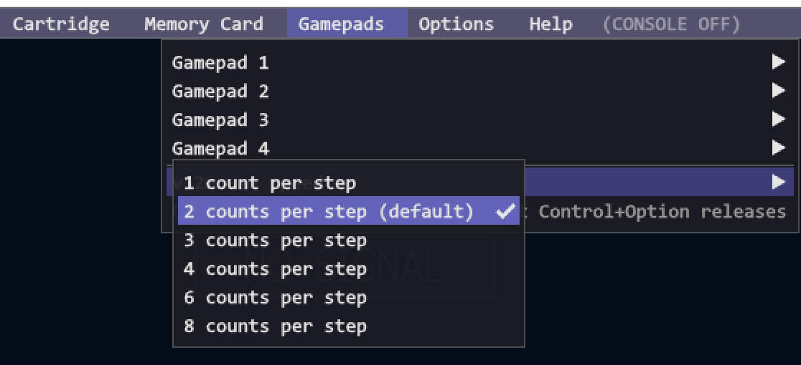

# patch the stock Vircon32 DesktopEmulator to provide emulated v32io peripherals

In  this directory  you will  find the  up-to-date patches  which can  be
applied  against  the  stock  Vircon32 DesktopEmulator  in  the  Vircon32
ComputerSoftware repository on github.

## apply the patches

To  apply  them,  you  will  first want  to  clone  the  ComputerSoftware
repository  to  your  computer  (or  download  one  of  the  source  code
releases).

Once in the  `ComputerSoftware/` directory, you can apply  the patches as
follows (in this order):

```
$ patch -p0 < v32kbd.patch
$ patch -p0 < v32mouse.patch
$ patch -p0 < v32kbd-text.patch
```

It is important that the patches are applied in this order: `v32kbd.patch`
first, then `v32mouse.patch`, then `v32kbd-text.patch`.

`v32kbd-text.patch` is  optional but recommended:  it makes `v32kbd` also
report  *typed  characters*  that  are  not  keys  on  a  US  keyboard:
accented letters, dead keys,  AltGr characters, and anything else your
operating system's keyboard layout can type  that the Vircon32 BIOS font
has (Windows-1252 letters and symbols, plus the box drawing characters).
Programs read them with `v32kbd_read()` / `v32kbd_glyph()` from the C
library (see `lib/README.md`); older programs ignore them.

## usage

Once  applied, build  the DesktopEmulator  according to  the usual  build
instructions for your platform.

After you've build and installed the DesktopEmulator, running it will now show `v32kbd` and `v32mouse` as available devices under the emulator's Gamepads menu:


NOTE  that  `v32kbd` and  the  default  `keyboard` devices  are  mutually
exclusive. Only  ONE can  be enabled  on any  gameport during  a session,
since they BOTH use the local system keyboard.

Additionally,  when  you  make  use  of  `v32mouse`,  under  the  gamepad
submenu  for that  port you've  connected  it, there  will be  additional
options/information available:



Under `v32mouse speed`  you can adjust the tracking speed  (in pixels) of
the emulated `v32mouse` device:



## typed characters (v32kbd-text.patch)

The emulator  keeps reporting keys  exactly as before. When  the host
types a character the BIOS font has but ASCII does not, the character is
reported *instead of* the key press that typed it, as two events: a
codepage prefix (key code 30 or 31) and a payload. See
`docs/PROTOCOLS.md` for the details.

To  find  out whether  a  key  press  typed something  else,  the
emulator holds back the press of every ASCII key until the host's text
for it  arrives (in the same frame); if none  comes, it is reported as a
key as usual. Automatic key repeat is still never reported.
