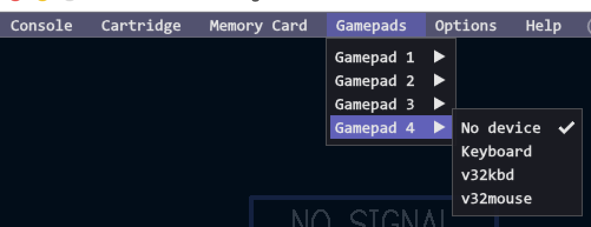

# v32io: patch the stock Vircon32 DesktopEmulator to provide emulated v32io peripherals

This is the emulator side of **v32io** (keyboard and mouse through gamepad
ports). The emulator side of **v32dev** (the memory card mailbox) is a
separate patch: see `../v32dev/README.md`. The two do not depend on each
other and touch different source files.

In  this directory  you will  find the  up-to-date patch  which can  be
applied  against  the  stock  Vircon32 DesktopEmulator  in  the  Vircon32
ComputerSoftware repository on github.

## the stock emulator and the fork

The  stock/official  Vircon32  DesktopEmulator  does not  include  support  for  any
`v32io`-based peripherals, so you have two options: patch the stock emulator
(below), or use the fork of the
[Vircon32 ComputerSoftware](https://github.com/wedge1020/ComputerSoftware/tree/v32io)
repository, under its `v32io` branch, which has this patch already
applied and implements the `v32io` peripherals at the emulator level,
requiring no physical hardware.

The use  of the provided `v32kbd`  device (under the Gamepad  menu), will
emulate the `v32io`  functionality on your system  keyboard, allowing for
the  full typing  experience  within Vircon32.  This  option is  mutually
exclusive with the existing `keyboard` device.  Only one or the other can
be enabled at any one time (on any gameport).

The use of the provided `v32mouse`  device (under the Gamepad menu), will
emulate the  `v32io` functionality with  your system mouse,  allowing for
mouse  functionality  within  Vircon32.  Note that  when  you  focus  the
Vircon32 DesktopEmulator window, the mouse  pointer WILL be captured, and
you  will need  to issue  `CTRL`+`ALT` (the  left `ALT`  specifically, to
reduce potential conflicts  with keyboards using `AltGr`)  to release the
pointer back to the system.

If you do not want to use the emulator devices, the `v32io` hardware
adapter (see `../../firmware/RP2350-USB-A/README.md`) works with the stock
emulator as it is.

## apply the patch

To  apply  it,  you  will  first  want  to  clone  the  ComputerSoftware
repository  to  your  computer  (or  download  one  of  the  source  code
releases).

`v32io.patch` is a single patch (it replaces the former `v32kbd.patch`,
`v32mouse.patch` and `v32kbd-text.patch`, which had to be applied in order)
made against the stock Vircon32 ComputerSoftware (upstream `main`,
commit `e47614b`). It changes only these files of
`DesktopEmulator/Emulator/`: `GUI.cpp`, `GamepadsInput.cpp`,
`GamepadsInput.hpp`, `Main.cpp` and `Settings.cpp`.

Once in the  `ComputerSoftware/` directory, apply it as follows (the
`.patch` file is the one in this directory, so give its path or copy it
over):

```
$ patch -p0 --dry-run < v32io.patch     # check first
$ patch -p0 < v32io.patch
$ patch -R -p0 < v32io.patch            # to take it out again
```

The patch includes the typed-characters support: it makes `v32kbd` also
report  *typed  characters*  that  are  not  keys  on  a  US  keyboard:
accented letters, dead keys,  AltGr characters, and anything else your
operating system's keyboard layout can type  that the Vircon32 BIOS font
has (Windows-1252 letters and symbols, plus the box drawing characters).
Programs read them with `v32kbd_read()` / `v32kbd_glyph()` from the C
library (see `lib/v32io/README.md`); older programs ignore them.

`mkpatch.sh <pristine tree> <patched tree> > v32io.patch` regenerates the
patch.

## usage

Once  applied, build  the DesktopEmulator  according to  the usual  build
instructions for your platform.

After you've build and installed the DesktopEmulator, running it will now show `v32kbd` and `v32mouse` as available devices under the emulator's Gamepads menu:



NOTE  that  `v32kbd` and  the  default  `keyboard` devices  are  mutually
exclusive. Only  ONE can  be enabled  on any  gameport during  a session,
since they BOTH use the local system keyboard.

Additionally,  when  you  make  use  of  `v32mouse`,  under  the  gamepad
submenu  for that  port you've  connected  it, there  will be  additional
options/information available:


Under `v32mouse speed`  you can adjust the tracking speed  (in pixels) of
the emulated `v32mouse` device:


## typed characters

The emulator  keeps reporting keys  exactly as before. When  the host
types a character the BIOS font has but ASCII does not, the character is
reported *instead of* the key press that typed it, as two events: a
codepage prefix (key code 30 or 31) and a payload. See
`docs/v32io/PROTOCOLS.md` for the details.

To  find  out whether  a  key  press  typed something  else,  the
emulator holds back the press of every ASCII key until the host's text
for it  arrives (in the same frame); if none  comes, it is reported as a
key as usual. Automatic key repeat is still never reported.
